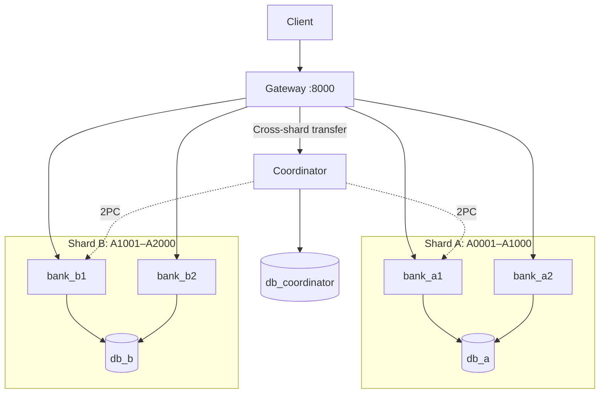
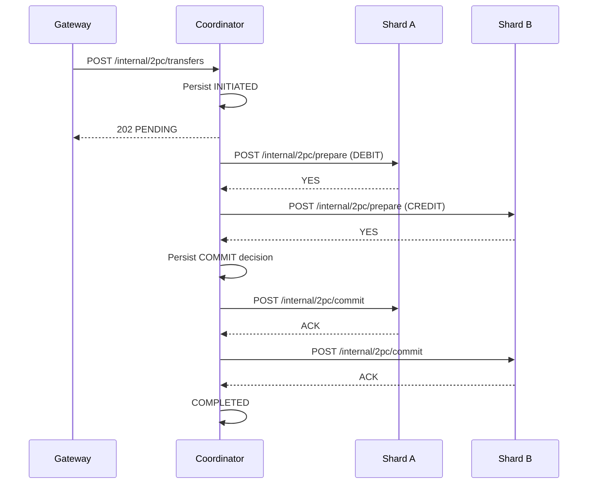

# Distributed Banking Platform

A distributed banking demo built with **Python 3.12, FastAPI, PostgreSQL, and Docker Compose**. It supports balance inquiries, deposits, withdrawals, same-shard transfers, and cross-shard transfers using **Two-Phase Commit (2PC)**.

## Architecture



The Gateway reads `config/shard_map.json` to determine the owning shard, then uses **Round Robin** among healthy replicas of that shard. Replicas share their shard's PostgreSQL database. Cross-shard transfers go through the Coordinator; requests are never routed to an unrelated shard on failover.

## Quick start

**Requirements:** Docker and Docker Compose.

```bash
cp .env.example .env
# Set BANK_DB_PASSWORD, COORD_DB_PASSWORD, and INTERNAL_API_TOKEN in .env
docker compose up -d --build
docker compose ps -a
```

The Gateway is available at **http://localhost:8000**; interactive API docs are at **http://localhost:8000/docs**.

On first initialization, PostgreSQL runs the schema SQL. The one-shot `seed_a` and `seed_b` services then populate accounts in their respective databases. Each Banking Replica starts after its shard's seed succeeds. The seed scripts use `ON CONFLICT (account_id) DO NOTHING`, so repeating them does not reset existing balances.

```bash
docker compose exec -T db_a psql -U banking -d banking -c "SELECT COUNT(*), MIN(account_id), MAX(account_id) FROM accounts;"
docker compose exec -T db_b psql -U banking -d banking -c "SELECT COUNT(*), MIN(account_id), MAX(account_id) FROM accounts;"
```

Expected on a clean deployment: **1,000 accounts per shard**. Avoid `docker compose down -v` unless you intend to delete the database volumes. PostgreSQL's `/docker-entrypoint-initdb.d` scripts run only when the data directory is initially empty.

## API endpoints

### Public API — Gateway (`http://localhost:8000`)

| Method | Endpoint | Description |
|---|---|---|
| `GET` | `/v1/accounts/{account_id}/balance` | Return an account's balance |
| `POST` | `/v1/accounts/{account_id}/deposits` | Deposit into an account |
| `POST` | `/v1/accounts/{account_id}/withdrawals` | Withdraw from an account |
| `POST` | `/v1/transfers` | Transfer between accounts; local or cross-shard |
| `GET` | `/v1/transactions/{transaction_id}` | Get a cross-shard transaction's status |
| `GET` | `/v1/internal/replicas` | Inspect shard-map epoch and replica health (Gateway diagnostics) |
| `GET` | `/health/live` | Gateway liveness check |
| `GET` | `/health/ready` | Gateway readiness check |

For `POST` deposits and withdrawals, send `{"amount_minor": 300}`. For `POST /v1/transfers`, send:

```json
{"source_account":"A0500","destination_account":"A1500","amount_minor":300}
```

All **public mutation endpoints** require an `Idempotency-Key` header containing a UUID. Amounts are positive integers in **minor units**. For an uncertain outcome, retry with the **same key and payload**. Cross-shard requests may return `202 PENDING`: use the status endpoint to check the final decision.

```bash
curl http://localhost:8000/v1/accounts/A0500/balance

curl -X POST http://localhost:8000/v1/transfers \
  -H 'Content-Type: application/json' \
  -H 'Idempotency-Key: 550e8400-e29b-41d4-a716-446655440000' \
  -d '{"source_account":"A0500","destination_account":"A1500","amount_minor":300}'
```

On Windows PowerShell, use `curl.exe` instead of the `curl` alias when running these examples.

### Internal API — Banking Replicas (`bank_a1`, `bank_a2`, `bank_b1`, `bank_b2`)

All endpoints below are registered under the **`/internal` prefix** in `services/banking/routes.py`.

| Method | Endpoint | Description |
|---|---|---|
| `GET` | `/internal/accounts/{account_id}/balance` | Read a balance from the owning shard |
| `POST` | `/internal/accounts/{account_id}/deposits` | Execute a deposit |
| `POST` | `/internal/accounts/{account_id}/withdrawals` | Execute a withdrawal |
| `POST` | `/internal/transfers/local` | Atomically transfer between accounts in one shard |
| `POST` | `/internal/2pc/prepare` | Prepare a debit/credit operation and vote YES/NO |
| `POST` | `/internal/2pc/commit` | Finalize a prepared transaction |
| `POST` | `/internal/2pc/abort` | Roll back a prepared transaction |
| `GET` | `/internal/2pc/{transaction_id}` | Inspect a participant's 2PC transaction state |

`/internal/accounts/.../deposits` and `withdrawals` use `AmountRequest`; `/internal/transfers/local` uses `TransferRequest`, with the same JSON bodies as their public equivalents. The 2PC messages use these bodies:

**`POST /internal/2pc/prepare` request body:**

```json
{
  "transaction_id": "550e8400-e29b-41d4-a716-446655440000",
  "request_hash": "<64-character lowercase SHA-256 hex string>",
  "account_id": "A0500",
  "operation": "DEBIT",
  "amount_minor": 300
}
```

**`POST /internal/2pc/commit` and `/internal/2pc/abort` request body:**

```json
{
  "transaction_id": "550e8400-e29b-41d4-a716-446655440000",
  "request_hash": "<same 64-character SHA-256 hex string>"
}
```

`operation` is `DEBIT` or `CREDIT`. The Coordinator constructs these protocol messages; clients should not call participant endpoints directly.

### Internal API — Coordinator

The Coordinator registers these endpoints under **`/internal/2pc`** in `services/coordinator/app.py`.

| Method | Endpoint | Description |
|---|---|---|
| `POST` | `/internal/2pc/transfers` | Create or retrieve a durable cross-shard transfer; may return `202 PENDING` |
| `GET` | `/internal/2pc/transactions/{transaction_id}` | Read the persisted transaction status, decision, and participant acknowledgements |

`POST /internal/2pc/transfers` uses the same `TransferRequest` JSON body as `/v1/transfers` and requires an `Idempotency-Key` UUID.

**Internal authentication:** All Banking and Coordinator `/internal/...` endpoints require `X-Internal-Token: <INTERNAL_API_TOKEN>`; otherwise they return `403`. The Gateway and Coordinator attach this header when forwarding requests. Banking and Coordinator also expose `GET /health/live` and `GET /health/ready` **without** the `/internal` prefix for health checks. The Gateway's `/v1/internal/replicas` is a separate diagnostics route, not part of the authenticated Banking/Coordinator internal routers. Only the Gateway port is published to the host by Compose.

## Transactions and recovery

Local mutations use PostgreSQL transactions, row-level locking or atomic updates, and stored **idempotency receipts**. Same-shard transfers debit and credit accounts in one database transaction. Cross-shard transfers use 2PC:



Participants use PostgreSQL `PREPARE TRANSACTION` followed by `COMMIT PREPARED` or `ROLLBACK PREPARED`. If preparation fails, the Coordinator persists **ABORT** instead. Its recovery worker scans unfinished transactions after a restart and retries the already-persisted decision; it does not reverse a durable COMMIT.

## Code structure

| Path | Responsibility |
|---|---|
| `services/gateway/app.py`, `routing.py`, `proxy.py` | Public routes, shard/replica selection, health monitoring, HTTP forwarding |
| `services/banking/app.py`, `routes.py` | Banking service startup, database pool, internal HTTP routes |
| `services/banking/operations.py`, `receipts.py` | Balance changes, local transfers, and idempotent request results |
| `services/banking/participant.py`, `participant_state.py` | 2PC prepare/commit/abort and participant state inspection |
| `services/coordinator/app.py`, `engine.py` | Coordinator API, background processing, and recovery scheduling |
| `services/coordinator/protocol.py`, `store.py`, `state_machine.py` | 2PC communication, durable decisions, state transitions |
| `shared/`, `config/shard_map.json` | Shared API contracts, validation, settings, and shard ownership |
| `database/`, `scripts/`, `tests/` | SQL schemas/seeds, failure demos, and automated tests |

## Tests and demos

```bash
python -m pip install -r requirements-dev.txt
python -m pytest tests/unit -q
RUN_INTEGRATION=1 python -m pytest tests/integration -q
python scripts/demo_failover.py
python scripts/demo_2pc_crash.py --point commit
```

Integration tests and demos require the Docker services. **Limitations:** database failover, live re-sharding, and autonomous self-healing are not implemented. Run crash-injection demos with test data only.
