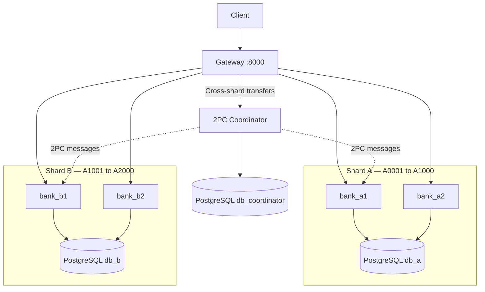
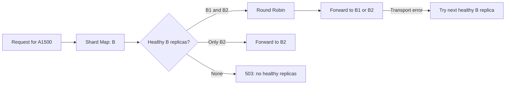
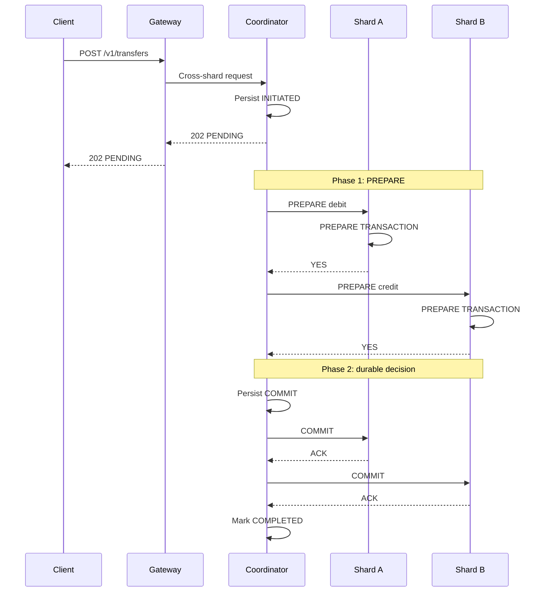

# Mini Banking Cluster (Distributed Systems — Assignment 2)

A distributed banking demo using **Python 3.12, FastAPI, PostgreSQL, and Docker Compose**. It supports balance inquiries, deposits, withdrawals, and local/cross-shard transfers.

## Architecture



| Shard | Accounts | Replicas |
|---|---|---|
| A | `A0001`–`A1000` | `bank_a1`, `bank_a2` |
| B | `A1001`–`A2000` | `bank_b1`, `bank_b2` |

The Gateway uses [`config/shard_map.json`](config/shard_map.json) to locate the account's shard, then selects a healthy replica with **Round Robin**. Both replicas of a shard use the same PostgreSQL database; the Coordinator handles cross-shard transfers.

### Request routing and replica failover



A failed replica never causes a request to be routed to a different shard.

## Quick start

**Requirements:** Docker and Docker Compose.

```bash
cp .env.example .env   # edit local credentials
# Apply the health-check fix below, then:
docker compose up -d --build
docker compose ps
```

Open **http://localhost:8000/docs** for the API documentation.

> **Note:** The current `compose.yaml` uses `curl` for application health checks, but the Python image does not include it. Replace its `&app-health` test with:
> ```yaml
> test: ["CMD", "python", "-c", "import urllib.request; urllib.request.urlopen('http://127.0.0.1:8000/health/ready', timeout=2)"]
> ```

## API

| Method | Endpoint | Purpose |
|---|---|---|
| `GET` | `/v1/accounts/{id}/balance` | Check balance |
| `POST` | `/v1/accounts/{id}/deposits` | Deposit |
| `POST` | `/v1/accounts/{id}/withdrawals` | Withdraw |
| `POST` | `/v1/transfers` | Transfer |
| `GET` | `/v1/transactions/{id}` | 2PC status |

```bash
curl http://localhost:8000/v1/accounts/A0500/balance

curl -X POST http://localhost:8000/v1/transfers \
  -H 'Content-Type: application/json' \
  -H 'Idempotency-Key: 550e8400-e29b-41d4-a716-446655440000' \
  -d '{"source_account":"A0500","destination_account":"A1500","amount_minor":300}'
```

Amounts use integer **minor units**. Retry uncertain requests with the **same** `Idempotency-Key`. Cross-shard transfers may return `202 PENDING`; query the transaction status for the final result.

## Transactions and two-phase commit (2PC)

Local operations use PostgreSQL transactions and row locks; stored request receipts prevent duplicate effects. For transfers across shards, the Coordinator uses PostgreSQL prepared transactions:



If any participant rejects PREPARE, the Coordinator records **ABORT** instead. After a crash, its recovery worker resumes the **persisted decision** and retries outstanding messages until all participants acknowledge it.

## Files

```text
services/gateway/       Routing and replica health
services/banking/       Banking operations and 2PC participants
services/coordinator/   2PC and recovery
shared/ & config/       Contracts and shard map
database/               Schemas and seed data
scripts/ & tests/       Demonstrations and tests
compose.yaml            Deployment
```

## Tests and demos

```bash
python -m pip install -r requirements-dev.txt
python -m pytest tests/unit -q
RUN_INTEGRATION=1 python -m pytest tests/integration -q  # Docker required
python scripts/demo_failover.py
python scripts/demo_2pc_crash.py --point commit
```

**Limitations:** No database failover, live re-sharding (Bonus I), or autonomous self-healing (Bonus II). Run crash demos with test data only. Avoid `docker compose down -v` unless you intend to delete the databases.
