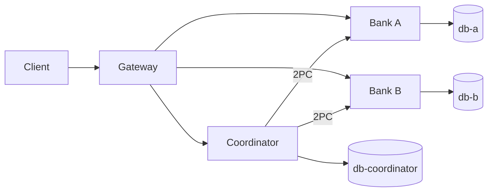

# Distributed Banking Platform

Python 3.12 · FastAPI · PostgreSQL · Docker Compose · Kubernetes

Sharded accounts, replicated applications, durable receipts and cross-shard 2PC.



| Directory | Purpose |
|---|---|
| `services/` | Gateway, banking, coordinator APIs |
| `shared/`, `config/` | Contracts, utilities and shard maps |
| `database/` | SQL schemas and non-resetting seed |
| `k8s/` | Base manifests, Minikube and bonus overlays |
| `scripts/` | Experiments, SQL audits and recovery helpers |
| `tests/` | Offline unit tests |
| `backup_dr.sh` | Explicit backup / disaster recovery command |
| `evidence/` | Generated logs (not committed) |

## Setup

Create `.env` from `.env.example` only for a new checkout; preserve the existing `.env` when upgrading. Set local credentials (DB passwords: letters, digits, `_`, `-`).

```bash
python -m venv .venv
source .venv/bin/activate
cp .env.example .env    # new checkout only
make install
make preflight
```

| Stage | Start / run | Guide |
|---|---|---|
| Assignment 2 | `make up`, `make a2` | Compose; `make down` preserves volumes |
| Assignment 3 | `make k8s`, `make a3` | [Minikube](k8s/README.md) |
| Bonus I | `bash k8s/bonus1/demo.sh check` | [Three-VM cluster](k8s/bonus1/README.md) |
| Bonus II | `bash k8s/bonus2/deploy.sh` | [DR setup](k8s/bonus2/README.md) |
| Manual backup | `bash backup_dr.sh` | Physical backup of all three databases |

For Minikube, keep `kubectl -n banking port-forward svc/gateway 8000:8000` running in a separate terminal. Use a separate kubeadm context for bonuses; never redeploy an existing healthy cluster just to run experiments.

| Command | Purpose |
|---|---|
| `make a3-list` | List seven experiments |
| `make a3-pause` | Run with pauses |
| `python -m scripts.assignment3.run_all 2 4 6` | Selected experiments |
| `make a3-check` | Live SQL audit |
| `make unit` / `make lint` | Offline tests / lint |
| `bash backup_dr.sh --help` | Backup and recovery options |

## API

Gateway: `http://127.0.0.1:8000` · OpenAPI: `/docs`

| Method | Path |
|---|---|
| GET | `/v1/accounts/{account_id}/balance` |
| POST | `/v1/accounts/{account_id}/deposits` |
| POST | `/v1/accounts/{account_id}/withdrawals` |
| POST | `/v1/transfers` |
| GET | `/v1/transactions/{transaction_id}` |
| GET | `/v1/internal/replicas` |
| GET | `/health/live`, `/health/ready`, `/metrics` |

Accounts A0001–A1000 belong to Bank A; A1001–A2000 belong to Bank B. Amounts are integer minor units. Every write requires a UUID `Idempotency-Key`; retries must reuse the same key and body. A timeout or `202 PENDING` is not success. Cross-shard writes use PREPARE, durable COMMIT/ABORT and participant acknowledgments. Internal APIs require `X-Internal-Token`.

## Safety

Base Kubernetes uses ANY 1; Bonus I uses ANY 2 synchronous acknowledgments. Keep backups outside all three VMs. Bonus II deploy configures continuous WAL archiving only; base backups are requested explicitly. Verify isolated restore before permanent failure tests. Never force unsafe promotion, edit balances/decisions manually, or delete live PVCs.
